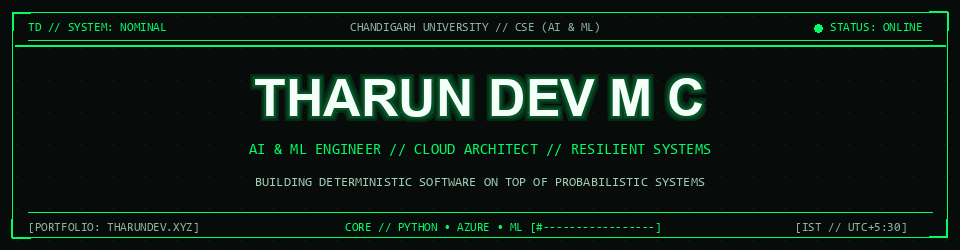
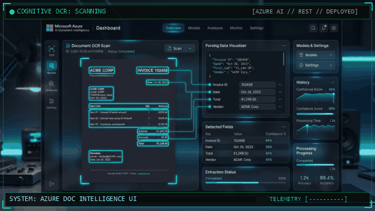
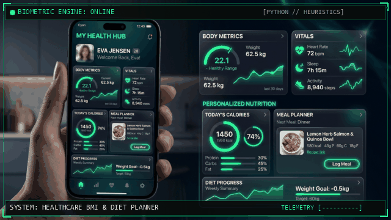

<div align="center">

<!-- ========================================================================
     ANIMATED CYBER HEADER GIF (NAME & HUD TELEMETRY)
     ======================================================================== -->
<a href="https://tharundev.xyz" target="_blank">
  
</a>

<!-- ========================================================================
     ANIMATED TYPING INTRODUCTION (README TYPING SVG)
     ======================================================================== -->
<a href="https://tharundev.xyz">
  
</a>

<br/>

<!-- ========================================================================
     QUICK PROFILE BADGES (SHIELDS.IO - LIME & CHARCOAL PALETTE)
     ======================================================================== -->
<p align="center">
  <a href="https://tharundev.xyz" target="_blank">
    
  </a>
  <a href="https://www.linkedin.com/in/tharundevmc/" target="_blank">
    
  </a>
  <a href="mailto:tharundevmc@gmail.com">
    
  </a>
  <a href="https://github.com/tharundev-123">
    
  </a>
</p>

<!-- Animated Cyber Pulse Line Divider -->


</div>

<br/>

---

##  01 // Architectural Profile & Principles


> **"Building deterministic software on top of probabilistic systems."**  
> *Engineering software at the nexus of mathematical machine learning models and deterministic production infrastructure.*

<table>
  <tr>
    <td width="62%" valign="top">
      <p>I am an <b>Artificial Intelligence & Machine Learning Engineer</b> and Computer Science student pursuing my <b>B.Tech in Computer Science & Engineering (AI & ML)</b> at <b>Chandigarh University</b>, native to Kozhikode, Kerala, India.</p>
      <p>My engineering methodology emphasizes disciplined software architecture over superficial demos. I build robust data pipelines in <b>Python</b>, explore cloud-native cognitive systems on <b>Microsoft Azure</b>, and deploy resilient multi-cloud infrastructure with <b>Nutanix</b>.</p>
      <p><b>Core Mission:</b> To design high-reliability AI platforms and scalable backend infrastructure that extract structured signal from ambiguous real-world data, translating complex models into tangible engineering outcomes.</p>
    </td>
    <td width="38%" align="center" valign="middle">
      
    </td>
  </tr>
</table>

### 🔬 Technical Dossier

| Metric / Attribute | Specification |
| :--- | :--- |
| **Full Name** | **THARUN DEV M C** |
| **Discipline** | B.Tech Computer Science & Engineering (Specialization in AI & ML) |
| **Institution** | **Chandigarh University**, Punjab / UP, India |
| **Academic Timeline** | 2025 – Present `[Undergraduate • Active Pursuit]` |
| **Geographic Origin** | Kozhikode, Kerala, India `[IST / UTC+5:30]` |
| **Core Architecture** | Python • Microsoft Azure Cloud • REST APIs • Machine Learning |
| **Primary Accreditations** | Microsoft Certified (AZ-900, AI-900, DP-600) • Nutanix Certified (NCP-MCI 6, NCP-EUC 6, NCA 6) |
| **Current Availability** | Open for High-Impact Software Engineering & AI/ML Internships |

<br/>

---

##  02 // Technical Skills & Architecture


```ascii
[SYSTEM_ARCHITECTURE] ───► (PYTHON) ───► [AZURE COGNITIVE SERVICES] ───► (REPRODUCIBLE PRODUCTION)
```

<div align="center">
  
</div>

<br/>

### ⚡ Proficiency & Domain Mastery

```ascii
┌──────────────────────┬──────────────────────────────────────────┬────────┐
│ DOMAIN               │ ARCHITECTURAL PROFICIENCY                │ STATUS │
├──────────────────────┼──────────────────────────────────────────┼────────┤
│ Python Architecture  │ [████████████████████████████████░░░░░░] │ 85%    │
│ Microsoft Azure AI   │ [██████████████████████████████░░░░░░░░] │ 80%    │
│ Multicloud (Nutanix) │ [██████████████████████████████████░░░░] │ 90%    │
│ Algorithms & C++     │ [████████████████████████████░░░░░░░░░░] │ 75%    │
│ RESTful Integrations │ [████████████████████████████████░░░░░░] │ 85%    │
└──────────────────────┴──────────────────────────────────────────┴────────┘
```

<br/>

<table>
  <tr>
    <td width="50%" valign="top">
      <h3 align="left">💻 Programming Languages</h3>
      <ul>
        <li><b>Python</b> <code>[Primary • Intermediate • Systems Architecture]</code></li>
        <li><b>C++</b> <code>[Algorithmic Heuristics & Data Structures]</code></li>
        <li><b>C Language</b> <code>[Low-Level Systems & Memory Model]</code></li>
        <li><b>SQL / Relational Schema</b> <code>[PostgreSQL / Lakehouse]</code></li>
        <li><b>HTML5 & CSS3</b> <code>[Modern Responsive Brutalist UIs]</code></li>
      </ul>
    </td>
    <td width="50%" valign="top">
      <h3 align="left">☁️ Cloud & Cognitive Architecture</h3>
      <ul>
        <li><b>Microsoft Azure Cloud</b> <code>[AZ-900 Certified]</code></li>
        <li><b>Azure AI & Cognitive Services</b> <code>[AI-900 Certified]</code></li>
        <li><b>Microsoft Fabric Analytics</b> <code>[DP-600 Certified]</code></li>
        <li><b>Nutanix Multicloud Infrastructure</b> <code>[NCP-MCI 6 Certified]</code></li>
        <li><b>Nutanix EUC & Automation</b> <code>[NCP-EUC 6 & NCA 6 Certified]</code></li>
      </ul>
    </td>
  </tr>
  <tr>
    <td width="50%" valign="top">
      <h3 align="left">⚙️ Tooling, Workflows & DevOps</h3>
      <ul>
        <li><b>Git & Version Control</b> <code>[Branching • Interactive Rebasing]</code></li>
        <li><b>GitHub CI/CD & Actions</b> <code>[Automated Build / Deploy Pipelines]</code></li>
        <li><b>VS Code</b> <code>[Primary Development Environment]</code></li>
        <li><b>Linux & Bash Shell</b> <code>[CLI Automation & Scripting]</code></li>
        <li><b>Postman</b> <code>[REST API Profiling & Contract Testing]</code></li>
        <li><b>Jupyter Notebooks</b> <code>[Exploratory Data Analysis & ML]</code></li>
      </ul>
    </td>
    <td width="50%" valign="top">
      <h3 align="left">📐 Engineering Foundations</h3>
      <ul>
        <li><b>Data Structures & Algorithms</b> <code>[Academic & Applied Focus]</code></li>
        <li><b>Machine Learning Heuristics</b> <code>[Predictive Modeling]</code></li>
        <li><b>RESTful API Design</b> <code>[Structured Payloads & Microservices]</code></li>
        <li><b>Software Engineering Lifecycle</b> <code>[Clean Architecture]</code></li>
        <li><b>Active Horizons:</b> LLMs, Deep Learning, Hybrid Cloud Orchestration</li>
      </ul>
    </td>
  </tr>
</table>

<br/>

---

##  03 // Featured Projects


### 01/ [Azure Document Intelligence UI](https://github.com/tharundev-123/azure-doc-analyzer)
> **Cognitive OCR & Structured Schema Extraction Pipeline**  
> An end-to-end cloud interface orchestrating Microsoft Azure Cognitive Services to extract structured tabular schemas and key-value records from unstructured document assets.

<!-- Animated Interactive Project Showcase -->
<div align="center">
  <a href="https://tharundev-123.github.io/azure-doc-analyzer/" target="_blank">
    
  </a>
</div>

<!-- Animated CLI Execution Stream -->
<div align="center">
  
</div>

<p align="center">
  <a href="https://github.com/tharundev-123/azure-doc-analyzer">
    
  </a>
  <a href="https://tharundev-123.github.io/azure-doc-analyzer/" target="_blank">
    
  </a>
  
</p>

- **Problem & Context:** Manual document auditing for invoices, receipts, and tax forms is labor-intensive and error-prone. Raw OCR tools frequently lose cell relationships and semantic entity pairings.
- **Key Contribution:** Designed the API integration layer interfacing with Microsoft Azure Cognitive Document Intelligence REST endpoints. Implemented parsing logic in Python to organize extracted text bounding boxes, table rows, and key-value confidence scores for web presentation.
- **Tech Stack:** `Microsoft Azure` `Document AI API` `Python REST` `GitHub Pages`
- **Actions:** [Inspect Source Code](https://github.com/tharundev-123/azure-doc-analyzer) • [Launch Live Demo](https://tharundev-123.github.io/azure-doc-analyzer/)

<details>
<summary><b>🔍 View Architectural Pipeline</b></summary>

```ascii
[PDF / Image Asset] ──► [Azure Document AI Engine] ──► [Key-Value & Table Parser] ──► [Structured UI Grid]
```
</details>

<div align="center">
  
</div>

<br/>

### 02/ [Digital Healthcare BMI & Diet Planner](https://github.com/tharundev-123/Nimbus_Project_THARUNDEVMC_76)
> **Biometric Categorization & Dynamic Nutritional Prescription Engine**  
> An intelligent healthcare computational tool combining biometric categorization algorithms with dynamic nutritional prescription synthesis (Project 76).

<!-- Animated Interactive Project Showcase -->
<div align="center">
  <a href="https://github.com/tharundev-123/Nimbus_Project_THARUNDEVMC_76" target="_blank">
    
  </a>
</div>

<!-- Animated CLI Execution Stream -->
<div align="center">
  
</div>

<p align="center">
  <a href="https://github.com/tharundev-123/Nimbus_Project_THARUNDEVMC_76">
    
  </a>
  
</p>

- **Problem & Context:** Standard health calculators provide static BMI numbers without actionable algorithmic dietary frameworks tailored to individual metabolic goals.
- **Key Contribution:** Engineered the core calculation logic in Python, implementing custom categorization algorithms and rule-based nutritional matrices that dynamically compute macronutrient distributions.
- **Tech Stack:** `Python` `ML Heuristics` `HTML5/CSS3` `Data Analytics`
- **Actions:** [Inspect Source Code](https://github.com/tharundev-123/Nimbus_Project_THARUNDEVMC_76)

<details>
<summary><b>🔍 View Biometric Heuristic Flow</b></summary>

```ascii
[Biometric Inputs] ──► [Metabolic Calculation Engine] ──► [Nutrient Ratio Matrix] ──► [Dynamic Diet Blueprint]
```
</details>

<div align="center">
  
</div>

<br/>

### 03/ [BrightLoop Subscription Manager](https://github.com/tharundev-123/brightloop-subscription-manager)
> **Full-Stack Enterprise Subscription Billing & Finance Dashboard**  
> Comprehensive subscription management platform featuring tier modeling, quotation lifecycles, automated invoice generation, and financial accounting views.

<!-- Animated CLI Execution Stream -->
<div align="center">
  
</div>

<p align="center">
  <a href="https://github.com/tharundev-123/brightloop-subscription-manager">
    
  </a>
  
  
</p>

- **Problem & Context:** SaaS businesses encounter billing leakages when subscription plans, custom quotes, discount structures, and ledger entries operate in isolated tools.
- **Key Contribution:** Developed a responsive full-stack platform managing subscription plans, quote-to-invoice workflows, automated tax/discount calculations, and relational transaction persistence.
- **Tech Stack:** `React` `TypeScript` `Node.js` `PostgreSQL`
- **Actions:** [Inspect Source Code](https://github.com/tharundev-123/brightloop-subscription-manager)

<div align="center">
  
</div>

<br/>

### 04/ [FaceVision Azure](https://github.com/tharundev-123/facevision-azure)
> **Cognitive Biometric Face Detection & Attribute Analysis**  
> Human face detection and visual attribute inspection system utilizing Microsoft Azure Cognitive Face APIs.

<!-- Animated CLI Execution Stream -->
<div align="center">
  
</div>

<p align="center">
  <a href="https://github.com/tharundev-123/facevision-azure">
    
  </a>
  
</p>

- **Problem & Context:** Automated visual recognition pipelines require precise landmark localization, facial posture detection, and low-latency feature extraction.
- **Key Contribution:** Implemented client-to-cloud integration with Azure Cognitive Services, parsing visual stream inputs and rendering bounding coordinates with attribute analytics.
- **Tech Stack:** `Microsoft Azure` `Cognitive Services Face API` `Python` `Web UI`
- **Actions:** [Inspect Source Code](https://github.com/tharundev-123/facevision-azure)

<div align="center">
  
</div>

<br/>

### 05/ [GlucoTwin AI](https://github.com/tharundev-123/GlucoTwin_AI)
> **Predictive Glycemic Spike Forecasting Prototype**  
> Machine learning driven health intelligence engine predicting glucose fluctuations using historical patient records and simulated continuous glucose monitor telemetry.

<!-- Animated CLI Execution Stream -->
<div align="center">
  
</div>

<p align="center">
  <a href="https://github.com/tharundev-123/GlucoTwin_AI">
    
  </a>
  
</p>

- **Problem & Context:** Latency in anticipating postprandial glucose surges poses immediate risks for diabetic patients requiring preemptive insulin adjustments.
- **Key Contribution:** Engineered predictive models analyzing time-series glucose curves and nutritional inputs to identify metabolic spike indicators.
- **Tech Stack:** `TypeScript` `Machine Learning Heuristics` `Predictive Analytics`
- **Actions:** [Inspect Source Code](https://github.com/tharundev-123/GlucoTwin_AI)

<div align="center">
  
</div>

<br/>

### 06/ [Ghost Data Deletion Audit Agent](https://github.com/tharundev-123/ghost-data-deletion-audit-agent)
> **AI-Powered Autonomous Deletion & Right-to-be-Forgotten Compliance Auditor**  
> Autonomous compliance audit agent built for HackerRank Orchestrate that proves whether user personal data is truly purged across databases, logs, backups, and replication streams.

<!-- Animated CLI Execution Stream -->
<div align="center">
  
</div>

<p align="center">
  <a href="https://github.com/tharundev-123/ghost-data-deletion-audit-agent">
    
  </a>
  
</p>

- **Problem & Context:** Regulatory compliance (GDPR, CCPA) requires verifiable evidence that user data deletion commands cascade completely across all cold backups and cache tiers.
- **Key Contribution:** Architected an autonomous agent that generates cryptographic verification trails and monitors distributed persistence layers for residual data traces.
- **Tech Stack:** `Python` `AI Agent Orchestration` `Compliance Verification`
- **Actions:** [Inspect Source Code](https://github.com/tharundev-123/ghost-data-deletion-audit-agent)

<br/>

---

##  04 // Certifications & Achievements


Authentic industry accreditations verified through **Credly**, **Microsoft Learn**, and **Coursera**:

| Credential ID | Certification Title | Issuing Body | Verification Link |
| :--- | :--- | :--- | :--- |
| **AZ-900** | **Microsoft Certified: Azure Fundamentals** | Microsoft | [](https://www.credly.com/badges/fa072f2b-6cb1-410d-867f-b103b02a89f9/public_url) |
| **AI-900** | **Microsoft Certified: Azure AI Fundamentals** | Microsoft | [](https://www.credly.com/badges/28fee6de-582e-48ac-8ad6-ca57f009ef39/public_url) |
| **DP-600 / DP-700** | **Microsoft Certified: Fabric Data Engineer Associate** | Microsoft | [](https://learn.microsoft.com/api/credentials/share/en-us/TharundevMC-1660/C260B7AABE3F829E?sharingId=9A9A67C29593A58D) |
| **NCP-MCI 6** | **Nutanix Certified Professional: Multicloud Infrastructure 6** | Nutanix | [](https://www.credly.com/badges/8c8c4eee-e4f5-4688-9663-e5dc3cf10b7b/public_url) |
| **NCP-EUC 6** | **Nutanix Certified Professional: End User Computing 6** | Nutanix | [](https://www.credly.com/badges/cd68b23d-4513-4149-8208-b95ae4269376/public_url) |
| **NCA 6 / NCP-MCA** | **Nutanix Certified Associate: Multicloud Automation 6** | Nutanix | [](https://www.credly.com/badges/a2039131-1ed7-493b-aa1c-e0c35acf8ea6/public_url) |
| **PYTHON** | **Introduction to Python Programming** | University of Pennsylvania | [](https://www.coursera.org/account/accomplishments/verify/YC9OSTN0A2IZ) |

### 🎓 Academic Honors & Milestones
- **Higher Secondary Education (12th Grade Science):** Graduated with **90% Distinction** (Physics, Chemistry, Mathematics, Computer Science) under Kerala Board of Higher Secondary Education.
- **Secondary Technical Education (10th Grade):** Graduated with **Above 90% Honors** under Technical Education Department, Kerala.

<br/>

---

## 📊 05 // GitHub Statistics & Activity

<div align="center">
  <table border="0">
    <tr>
      <td align="center" width="50%">
        
      </td>
      <td align="center" width="50%">
        
      </td>
    </tr>
  </table>
</div>

<br/>

---

## 🔥 06 // Contribution Streak

<div align="center">
  
</div>

<br/>

---

## 🐍 07 // Contribution Grid Snake

<div align="center">
  <picture>
    <source media="(prefers-color-scheme: dark)" srcset="https://raw.githubusercontent.com/tharundev-123/tharundev-123/output/github-contribution-grid-snake-dark.svg">
    <source media="(prefers-color-scheme: light)" srcset="https://raw.githubusercontent.com/tharundev-123/tharundev-123/output/github-contribution-grid-snake.svg">
    
  </picture>
</div>

<br/>

---

## 📡 08 // Connect With Me

Whether discussing software engineering internships, AI/ML research collaborations, or enterprise cloud solutions, my communication channels are open:

<div align="center">
  <a href="https://tharundev.xyz" target="_blank">
    
  </a>
  &nbsp;
  <a href="https://www.linkedin.com/in/tharundevmc/" target="_blank">
    
  </a>
  &nbsp;
  <a href="https://github.com/tharundev-123" target="_blank">
    
  </a>
  &nbsp;
  <a href="mailto:tharundevmc@gmail.com">
    
  </a>
</div>

<br/>

<!-- ========================================================================
     STYLISH ANIMATED FOOTER (CAPSULE RENDER)
     ======================================================================== -->
<div align="center">
  
  <p align="center">
    <sub>Designed with a futuristic brutalist aesthetic • Maintained by <b>Tharun Dev M C</b> • © 2026</sub>
  </p>
</div>
