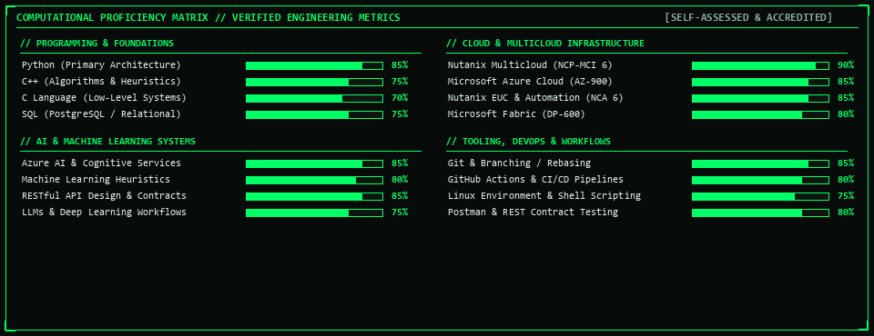
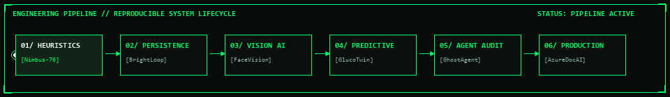

<div align="center">

<!-- ========================================================================
     00 // HERO CYBER HUD BANNER (ANIMATED NAME & TELEMETRY)
     ======================================================================== -->
<a href="https://tharundev.xyz" target="_blank">
  
</a>

<!-- ========================================================================
     ANIMATED TYPING TRANSMISSION
     ======================================================================== -->
<a href="https://tharundev.xyz">
  
</a>

<br/>

<!-- ========================================================================
     QUICK DISPATCH TELEMETRY DOCK
     ======================================================================== -->
<p align="center">
  <a href="https://tharundev.xyz" target="_blank">
    
  </a>
  &nbsp;
  <a href="https://www.linkedin.com/in/tharundevmc/" target="_blank">
    
  </a>
  &nbsp;
  <a href="mailto:tharundevmc@gmail.com">
    
  </a>
  &nbsp;
  <a href="https://github.com/tharundev-123">
    
  </a>
</p>

<!-- Animated Cyber Pulse Divider -->


</div>

<br/>

---

##  01 // System Dossier & Operating Philosophy


> **"Building deterministic software on top of probabilistic systems."**  
> *Engineering software at the nexus of mathematical machine learning models and deterministic production infrastructure.*

<table>
  <tr>
    <td width="60%" valign="top">
      <p>I am an <b>Artificial Intelligence & Machine Learning Engineer</b> pursuing my <b>B.Tech in Computer Science & Engineering (AI & ML)</b> at <b>Chandigarh University</b>, native to Kozhikode, Kerala, India.</p>
      <p>My methodology emphasizes disciplined software architecture over superficial demos. I build robust data pipelines in <b>Python</b>, explore cloud-native cognitive systems on <b>Microsoft Azure</b>, and deploy resilient multi-cloud infrastructure with <b>Nutanix</b>.</p>
      <p><b>Core Mission:</b> To design high-reliability AI platforms and scalable backend infrastructure that extract structured signal from ambiguous real-world data, translating complex models into tangible engineering outcomes.</p>
    </td>
    <td width="40%" align="center" valign="middle">
      
    </td>
  </tr>
</table>

### 🔬 Architecture & Specification Metrics

| Parameter | Specification & System Metrics |
| :--- | :--- |
| **Engineering Lead** | **THARUN DEV M C** |
| **Academic Program** | B.Tech Computer Science & Engineering (AI & Machine Learning Specialization) |
| **Academic Base** | **Chandigarh University**, UP, India `[2025 – Present • Active Pursuit]` |
| **Geographic Telemetry** | Kozhikode, Kerala, India `[IST / UTC+5:30]` |
| **Core Architecture** | Python Systems • Microsoft Azure Cloud • RESTful APIs • ML Heuristics |
| **Industrial Accreditations** | Microsoft Certified (AZ-900, AI-900, DP-600) • Nutanix Certified (NCP-MCI 6, NCP-EUC 6, NCA 6) |
| **Current Availability** | Open for High-Impact Software Engineering & AI/ML Internships |

<br/>

---

##  02 // Computational Arsenal & Proficiency Matrix


<!-- Animated Interactive Skills Progress Matrix -->
<div align="center">
  
</div>

<br/>

<!-- Interactive Technology Icon Matrix -->
<div align="center">
  
</div>

<br/>

<table>
  <tr>
    <td width="50%" valign="top">
      <h3 align="left">💻 Programming Languages & Foundations</h3>
      <ul>
        <li><b>Python</b> <code>[85%]</code> <code>[Primary • Intermediate • Systems Architecture]</code></li>
        <li><b>C++</b> <code>[75%]</code> <code>[Algorithmic Heuristics & Data Structures]</code></li>
        <li><b>C Language</b> <code>[70%]</code> <code>[Low-Level Systems & Memory Model]</code></li>
        <li><b>SQL / Schema</b> <code>[75%]</code> <code>[PostgreSQL / Lakehouse Relational Modeling]</code></li>
        <li><b>HTML5 & CSS3</b> <code>[80%]</code> <code>[Modern Responsive Brutalist Interfaces]</code></li>
      </ul>
    </td>
    <td width="50%" valign="top">
      <h3 align="left">☁️ Cloud & Cognitive Architecture</h3>
      <ul>
        <li><b>Nutanix Multicloud Infrastructure</b> <code>[90%]</code> <code>[NCP-MCI 6 Certified]</code></li>
        <li><b>Microsoft Azure Cloud</b> <code>[85%]</code> <code>[AZ-900 Certified]</code></li>
        <li><b>Azure AI & Cognitive Services</b> <code>[85%]</code> <code>[AI-900 Certified]</code></li>
        <li><b>Nutanix EUC & Automation</b> <code>[85%]</code> <code>[NCP-EUC 6 & NCA 6 Certified]</code></li>
        <li><b>Microsoft Fabric Analytics</b> <code>[80%]</code> <code>[DP-600 Certified]</code></li>
      </ul>
    </td>
  </tr>
  <tr>
    <td width="50%" valign="top">
      <h3 align="left">⚙️ Tooling, Workflows & DevOps</h3>
      <ul>
        <li><b>Git & Version Control</b> <code>[85%]</code> <code>[Branching • Interactive Rebasing]</code></li>
        <li><b>GitHub CI/CD & Actions</b> <code>[80%]</code> <code>[Automated Build / Deploy Pipelines]</code></li>
        <li><b>VS Code</b> <code>[90%]</code> <code>[Primary Development Environment]</code></li>
        <li><b>Linux & Bash Shell</b> <code>[75%]</code> <code>[CLI Automation & Scripting]</code></li>
        <li><b>Postman</b> <code>[80%]</code> <code>[REST API Profiling & Contract Testing]</code></li>
        <li><b>Jupyter Notebooks</b> <code>[85%]</code> <code>[Exploratory Data Analysis & ML]</code></li>
      </ul>
    </td>
    <td width="50%" valign="top">
      <h3 align="left">📐 Engineering Foundations & Horizons</h3>
      <ul>
        <li><b>Data Structures & Algorithms</b> <code>[75%]</code> <code>[Academic & Applied Focus]</code></li>
        <li><b>Machine Learning Heuristics</b> <code>[80%]</code> <code>[Predictive Modeling]</code></li>
        <li><b>RESTful API Design</b> <code>[85%]</code> <code>[Structured Payloads & Microservices]</code></li>
        <li><b>Software Engineering Lifecycle</b> <code>[85%]</code> <code>[Clean Architecture Standards]</code></li>
        <li><b>Active Horizons:</b> LLMs, Deep Learning, Hybrid Cloud Orchestration</li>
      </ul>
    </td>
  </tr>
</table>

<br/>

---

##  03 // The Engineering Pipeline · End-to-End Workflow


<!-- ========================================================================
     ANIMATED WORKFLOW FLOWCHART DIAGRAM
     ======================================================================== -->
<div align="center">
  
</div>

<br/>

Every project below corresponds to a critical phase in the end-to-end software and AI engineering lifecycle—demonstrating progression from initial mathematical heuristics to enterprise cloud production:

```ascii
[01 HEURISTICS] ──► [02 PERSISTENCE] ──► [03 COGNITIVE AI] ──► [04 PREDICTIVE ML] ──► [05 AUDIT AGENTS] ──► [06 PRODUCTION DEPLOYMENT]
```

<br/>

<!-- ========================================================================
     STAGE 01: HEURISTICS
     ======================================================================== -->
### ⬡ STAGE 01 // PROBLEM DISCOVERY & BIOMETRIC HEURISTICS
#### [Digital Healthcare BMI & Diet Planner](https://github.com/tharundev-123/Nimbus_Project_THARUNDEVMC_76) `[Nimbus Project 76]`
> **Formulation of mathematical heuristics and dynamic macronutrient synthesis rules.**

<!-- Animated UI Showcase -->
<div align="center">
  <a href="https://github.com/tharundev-123/Nimbus_Project_THARUNDEVMC_76" target="_blank">
    
  </a>
</div>

<!-- Animated CLI Execution Stream -->
<div align="center">
  
</div>

<p align="center">
  <a href="https://github.com/tharundev-123/Nimbus_Project_THARUNDEVMC_76">
    
  </a>
  
  
</p>

* **Lifecycle Purpose:** Establishes data ingestion rules, custom biometric classification matrices, and metabolic distribution formulas that translate raw human measurements into structured nutritional diets.
* **Architecture:** Core Python calculation engine with offline feedback loops and deterministic macronutrient matrices.
* **Artifacts & Verification:** [Inspect Source Code](https://github.com/tharundev-123/Nimbus_Project_THARUNDEVMC_76)

<details>
<summary><b>🔍 View Stage 01 Biometric Flow</b></summary>

```ascii
[Biometric Inputs: Height/Weight] ──► [Metabolic Engine] ──► [Nutrient Ratio Matrix] ──► [Dynamic Diet Blueprint]
```
</details>

<!-- Workflow Transition Connector -->
<div align="center">
  
  <br/>
  <sub><b>▼ STAGE 01 (HEURISTICS) ──► ADVANCING TO RELATIONAL TRANSACTION PERSISTENCE ──► STAGE 02 ▼</b></sub>
</div>

<br/>

<!-- ========================================================================
     STAGE 02: PERSISTENCE
     ======================================================================== -->
### ⬡ STAGE 02 // FULL-STACK ARCHITECTURE & FINANCIAL PERSISTENCE
#### [BrightLoop Subscription Manager](https://github.com/tharundev-123/brightloop-subscription-manager) `[Full-Stack SaaS Platform]`
> **Engineering relational transaction ledgers, tier modeling, and automated invoice rendering.**

<!-- Animated CLI Execution Stream -->
<div align="center">
  
</div>

<p align="center">
  <a href="https://github.com/tharundev-123/brightloop-subscription-manager">
    
  </a>
  
  
</p>

* **Lifecycle Purpose:** Scales simple business logic into production-grade multi-tier SaaS billing, quote lifecycles, automated PDF generation, and ACID-compliant relational persistence.
* **Architecture:** React + TypeScript client communicating with Node.js REST services and PostgreSQL relational schemas.
* **Artifacts & Verification:** [Inspect Source Code](https://github.com/tharundev-123/brightloop-subscription-manager)

<!-- Workflow Transition Connector -->
<div align="center">
  
  <br/>
  <sub><b>▼ STAGE 02 (PERSISTENCE) ──► ADVANCING TO DISTRIBUTED COGNITIVE INFERENCE ──► STAGE 03 ▼</b></sub>
</div>

<br/>

<!-- ========================================================================
     STAGE 03: VISION AI
     ======================================================================== -->
### ⬡ STAGE 03 // COMPUTER VISION & COGNITIVE INFERENCE
#### [FaceVision Azure](https://github.com/tharundev-123/facevision-azure) `[Cognitive Vision System]`
> **Real-time video stream ingestion and probabilistic landmark topology mapping.**

<!-- Animated CLI Execution Stream -->
<div align="center">
  
</div>

<p align="center">
  <a href="https://github.com/tharundev-123/facevision-azure">
    
  </a>
  
  
</p>

* **Lifecycle Purpose:** Integrates pre-trained cloud cognitive intelligence into edge visual feeds, generating low-latency biometric coordinate vectors and facial attribute telemetry.
* **Architecture:** Microsoft Azure Cognitive Face APIs, Python integration layer, OpenCV video capture, and browser visualizer.
* **Artifacts & Verification:** [Inspect Source Code](https://github.com/tharundev-123/facevision-azure)

<!-- Workflow Transition Connector -->
<div align="center">
  
  <br/>
  <sub><b>▼ STAGE 03 (COGNITIVE AI) ──► ADVANCING TO TIME-SERIES PREDICTIVE MODELING ──► STAGE 04 ▼</b></sub>
</div>

<br/>

<!-- ========================================================================
     STAGE 04: PREDICTIVE ML
     ======================================================================== -->
### ⬡ STAGE 04 // TIME-SERIES FORECASTING & PREDICTIVE MODELING
#### [GlucoTwin AI](https://github.com/tharundev-123/GlucoTwin_AI) `[Predictive Health Prototype]`
> **Evaluating continuous patient monitoring telemetry to anticipate volatile glycemic curves.**

<!-- Animated CLI Execution Stream -->
<div align="center">
  
</div>

<p align="center">
  <a href="https://github.com/tharundev-123/GlucoTwin_AI">
    
  </a>
  
  
</p>

* **Lifecycle Purpose:** Transitions from reactive processing to proactive temporal prediction—analyzing time-series telemetry streams to predict physiological spikes before they materialize.
* **Architecture:** TypeScript algorithms simulating continuous glucose monitoring (CGM) streams paired with predictive regression heuristics.
* **Artifacts & Verification:** [Inspect Source Code](https://github.com/tharundev-123/GlucoTwin_AI)

<!-- Workflow Transition Connector -->
<div align="center">
  
  <br/>
  <sub><b>▼ STAGE 04 (PREDICTIVE ML) ──► ADVANCING TO AUTONOMOUS AGENT AUDITING ──► STAGE 05 ▼</b></sub>
</div>

<br/>

<!-- ========================================================================
     STAGE 05: AGENT AUDIT
     ======================================================================== -->
### ⬡ STAGE 05 // AUTONOMOUS AGENT ORCHESTRATION & COMPLIANCE VERIFICATION
#### [Ghost Data Deletion Audit Agent](https://github.com/tharundev-123/ghost-data-deletion-audit-agent) `[HackerRank Orchestrate]`
> **Autonomous verification demonstrating mathematical proof of personal data eradication.**

<!-- Animated CLI Execution Stream -->
<div align="center">
  
</div>

<p align="center">
  <a href="https://github.com/tharundev-123/ghost-data-deletion-audit-agent">
    
  </a>
  
  
</p>

* **Lifecycle Purpose:** Implements autonomous agentic governance—verifying that user data deletion commands cascade completely across all cold backups, replica databases, and event buses.
* **Architecture:** Python agent engine generating cryptographic audit trails across distributed databases and long-term storage silos.
* **Artifacts & Verification:** [Inspect Source Code](https://github.com/tharundev-123/ghost-data-deletion-audit-agent)

<!-- Workflow Transition Connector -->
<div align="center">
  
  <br/>
  <sub><b>▼ STAGE 05 (AGENT AUDIT) ──► ADVANCING TO ENTERPRISE CLOUD DEPLOYMENT ──► STAGE 06 ▼</b></sub>
</div>

<br/>

<!-- ========================================================================
     STAGE 06: PRODUCTION DEPLOYMENT
     ======================================================================== -->
### ⬡ STAGE 06 // ENTERPRISE CLOUD ORCHESTRATION & PRODUCTION DEPLOYMENT
#### [Azure Document Intelligence UI](https://github.com/tharundev-123/azure-doc-analyzer) `[Live Enterprise Web Interface]`
> **Production-grade cloud cognitive pipeline orchestrating Azure Document AI with interactive web clients.**

<!-- Animated UI Showcase -->
<div align="center">
  <a href="https://tharundev-123.github.io/azure-doc-analyzer/" target="_blank">
    
  </a>
</div>

<!-- Animated CLI Execution Stream -->
<div align="center">
  
</div>

<p align="center">
  <a href="https://github.com/tharundev-123/azure-doc-analyzer">
    
  </a>
  <a href="https://tharundev-123.github.io/azure-doc-analyzer/" target="_blank">
    
  </a>
  
  
</p>

* **Lifecycle Purpose:** Complete production deployment—orchestrating cloud document OCR, tabular schema recognition, confidence scoring, and automated web publishing via GitHub Pages.
* **Architecture:** Microsoft Azure Cognitive REST APIs, Python parsing microservice, client-side UI, and zero-downtime GitHub Pages static hosting.
* **Artifacts & Verification:** [Inspect Source Code](https://github.com/tharundev-123/azure-doc-analyzer) • [Launch Live Demo](https://tharundev-123.github.io/azure-doc-analyzer/)

<details>
<summary><b>🔍 View Production Pipeline</b></summary>

```ascii
[PDF / Image Asset] ──► [Azure Document AI Engine] ──► [Key-Value & Table Parser] ──► [Structured UI Grid]
```
</details>

<div align="center">
  
  <br/>
  <sub><b>✔ COMPLETE REPRODUCIBLE LIFECYCLE: FROM MATHEMATICAL HEURISTIC TO CLOUD PRODUCTION ✔</b></sub>
</div>

<br/>

---

##  04 // Industrial Accreditations & Verified Credentials


Authentic industry accreditations verified through **Credly**, **Microsoft Learn**, and **Coursera**:

| Credential ID | Official Accreditation Title | Issuing Body | Direct Verification Link |
| :--- | :--- | :--- | :--- |
| **AZ-900** | **Microsoft Certified: Azure Fundamentals** | Microsoft | [](https://www.credly.com/badges/fa072f2b-6cb1-410d-867f-b103b02a89f9/public_url) |
| **AI-900** | **Microsoft Certified: Azure AI Fundamentals** | Microsoft | [](https://www.credly.com/badges/28fee6de-582e-48ac-8ad6-ca57f009ef39/public_url) |
| **DP-600 / DP-700** | **Microsoft Certified: Fabric Data Engineer Associate** | Microsoft | [](https://learn.microsoft.com/api/credentials/share/en-us/TharundevMC-1660/C260B7AABE3F829E?sharingId=9A9A67C29593A58D) |
| **NCP-MCI 6** | **Nutanix Certified Professional: Multicloud Infrastructure 6** | Nutanix | [](https://www.credly.com/badges/8c8c4eee-e4f5-4688-9663-e5dc3cf10b7b/public_url) |
| **NCP-EUC 6** | **Nutanix Certified Professional: End User Computing 6** | Nutanix | [](https://www.credly.com/badges/cd68b23d-4513-4149-8208-b95ae4269376/public_url) |
| **NCA 6 / NCP-MCA** | **Nutanix Certified Associate: Multicloud Automation 6** | Nutanix | [](https://www.credly.com/badges/a2039131-1ed7-493b-aa1c-e0c35acf8ea6/public_url) |
| **PYTHON** | **Introduction to Python Programming** | University of Pennsylvania | [](https://www.coursera.org/account/accomplishments/verify/YC9OSTN0A2IZ) |

### 🎓 Academic Honors & Computational Foundations
- **Higher Secondary Education (12th Grade Science):** Graduated with **90% Distinction** (Physics, Chemistry, Mathematics, Computer Science) under Kerala Board of Higher Secondary Education.
- **Secondary Technical Education (10th Grade):** Graduated with **Above 90% Honors** under Technical Education Department, Kerala.

<br/>

---

## 📊 05 // Telemetry, Commit Velocity & Code Analytics

<div align="center">
  <table border="0">
    <tr>
      <td align="center" width="50%">
        
      </td>
      <td align="center" width="50%">
        
      </td>
    </tr>
  </table>
</div>

<br/>

---

## 🔥 06 // Continuous Discipline & Streak Analytics

<div align="center">
  
</div>

<br/>

---

## 🐍 07 // The Contribution Ecosystem

<div align="center">
  <picture>
    <source media="(prefers-color-scheme: dark)" srcset="https://raw.githubusercontent.com/tharundev-123/tharundev-123/output/github-contribution-grid-snake-dark.svg">
    <source media="(prefers-color-scheme: light)" srcset="https://raw.githubusercontent.com/tharundev-123/tharundev-123/output/github-contribution-grid-snake.svg">
    
  </picture>
</div>

<br/>

---

## 📡 08 // Secure Transmission & Transmission Dock

Whether discussing software engineering internships, AI/ML research collaborations, or enterprise cloud solutions, my communication channels are open:

<div align="center">
  <a href="https://tharundev.xyz" target="_blank">
    
  </a>
  &nbsp;
  <a href="https://www.linkedin.com/in/tharundevmc/" target="_blank">
    
  </a>
  &nbsp;
  <a href="https://github.com/tharundev-123" target="_blank">
    
  </a>
  &nbsp;
  <a href="mailto:tharundevmc@gmail.com">
    
  </a>
</div>

<br/>

<!-- ========================================================================
     STYLISH ANIMATED FOOTER (CAPSULE RENDER)
     ======================================================================== -->
<div align="center">
  
  <p align="center">
    <sub>Designed with a futuristic brutalist aesthetic • Maintained by <b>Tharun Dev M C</b> • © 2026</sub>
  </p>
</div>
